# Computerized Bonsai Garden: UML

These diagrams are written in [Mermaid](https://mermaid.js.org/), which GitHub renders directly. To export images for slides or the report, paste a block into the [Mermaid Live Editor](https://mermaid.live) and download it as PNG or SVG.

The requirements, use cases and scenarios these diagrams refer to (UC1-UC18, F1-F22) are in [ANALYSIS.md](ANALYSIS.md).

**Contents**

1. [Use case diagram](#1-use-case-diagram)
2. [Class diagram: the garden model](#2-class-diagram-the-garden-model)
3. [Class diagram: modules and sensors](#3-class-diagram-modules-and-sensors)
4. [Class diagram: wildlife](#4-class-diagram-wildlife)
5. [Class diagram: user interface and logging](#5-class-diagram-user-interface-and-logging)
6. [State diagram: a plot](#6-state-diagram-a-plot)
7. [Sequence diagram: one simulation step](#7-sequence-diagram-one-simulation-step)
8. [Sequence diagram: a cockroach attack](#8-sequence-diagram-a-cockroach-attack)
9. [Sequence diagram: the gardener clicks a plot](#9-sequence-diagram-the-gardener-clicks-a-plot)
10. [Activity diagram: watering decision](#10-activity-diagram-watering-decision)
11. [Activity diagram: frame loop with error recovery](#11-activity-diagram-frame-loop-with-error-recovery)

---

## 1. Use case diagram

Mermaid has no native use case diagram, so this is drawn as a flowchart: actors are on the outside, and use cases are the rounded shapes inside the system boundary.

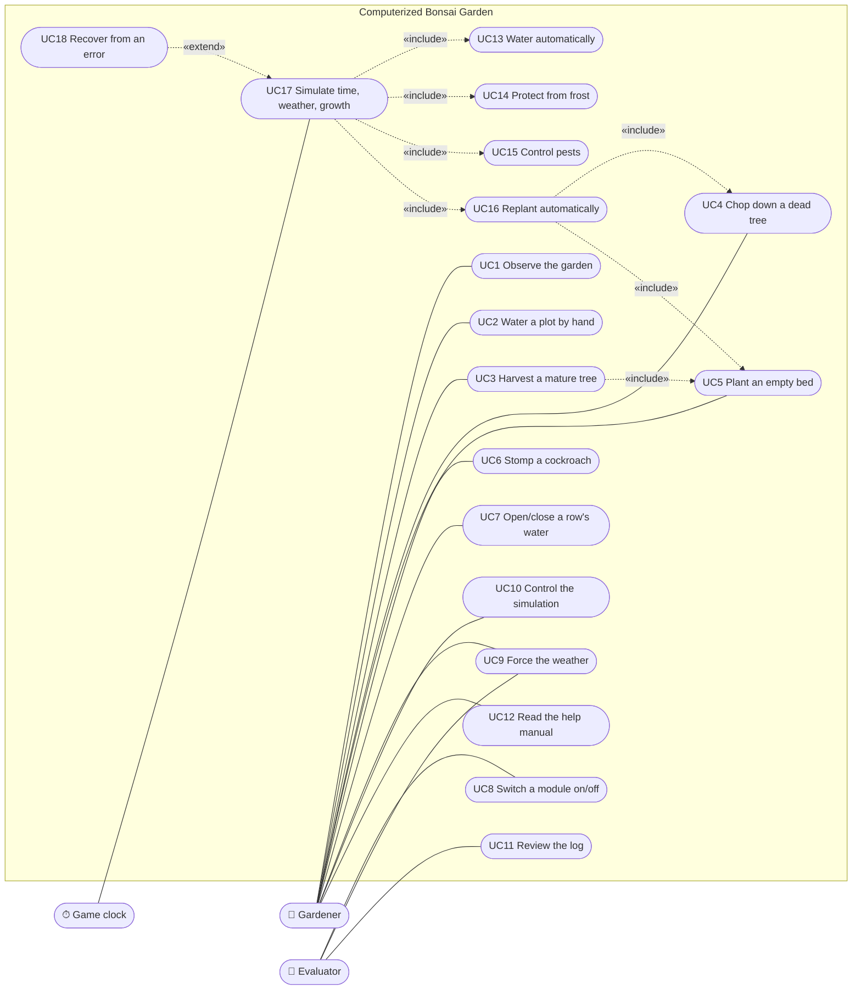

---

## 2. Class diagram: the garden model

`Garden` is the root of the model. It owns everything and advances it one step at a time.

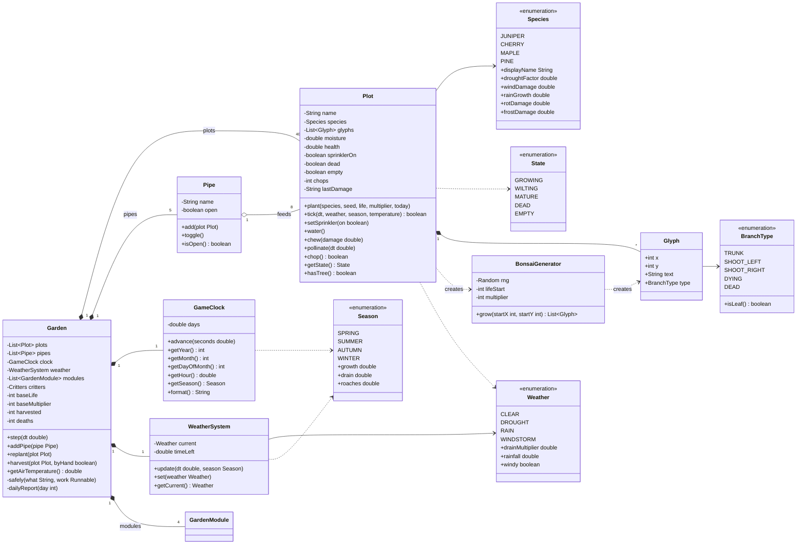

---

## 3. Class diagram: modules and sensors

Each automated subsystem extends `GardenModule`. `update()` is a **template method**: it is final, checks whether the module is enabled, then calls the subclass's `run()`. Modules read the world only through `Sensor`s.

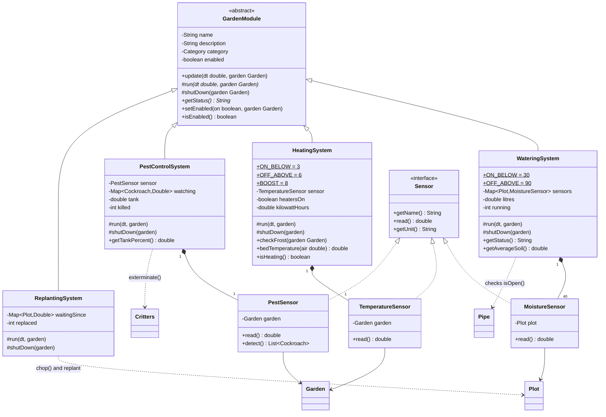

---

## 4. Class diagram: wildlife

`Critters` updates and draws every insect **polymorphically** through the abstract `Bug` methods.

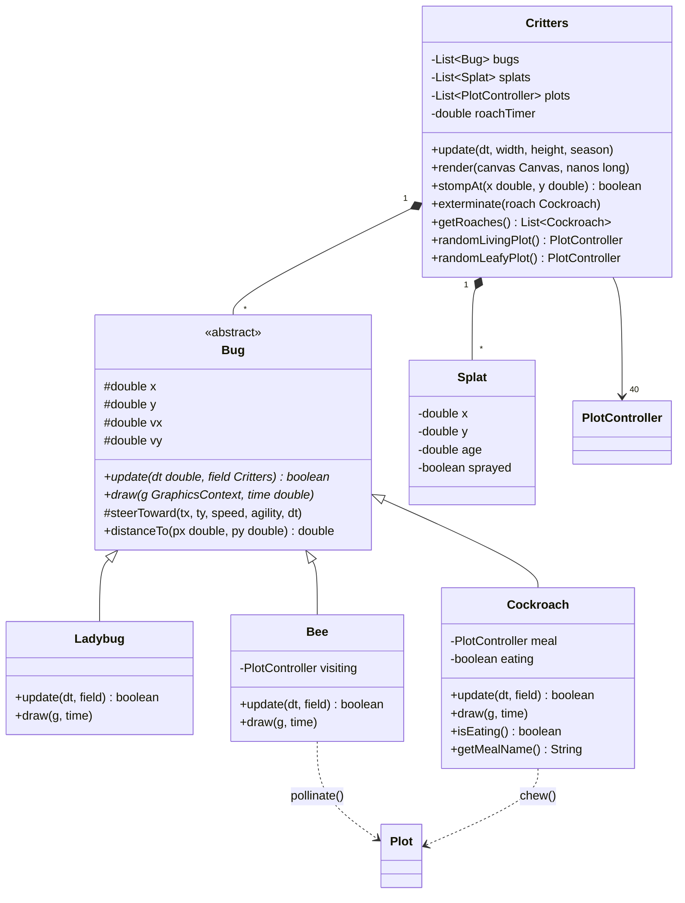

---

## 5. Class diagram: user interface and logging

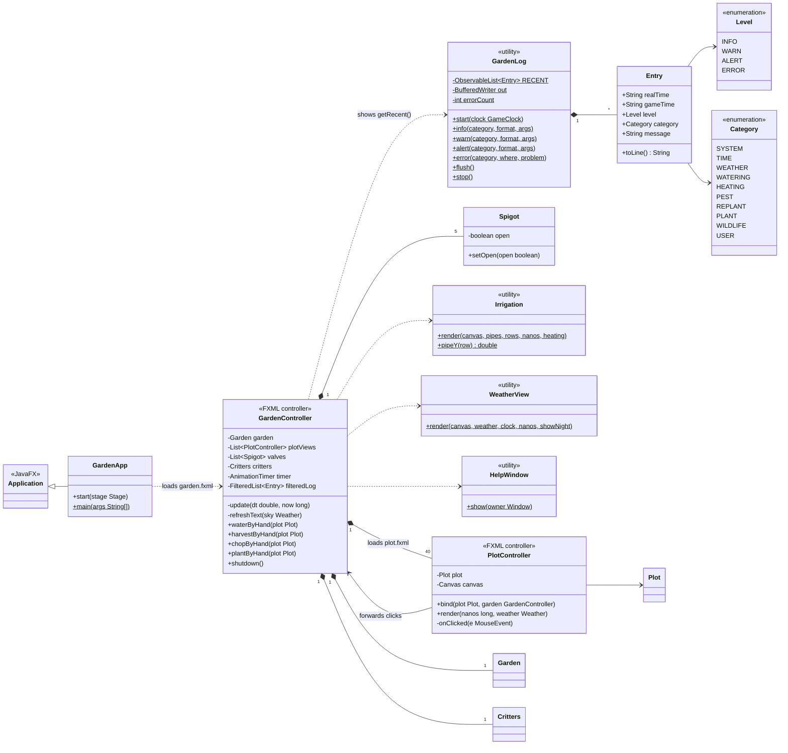

---

## 6. State diagram: a plot

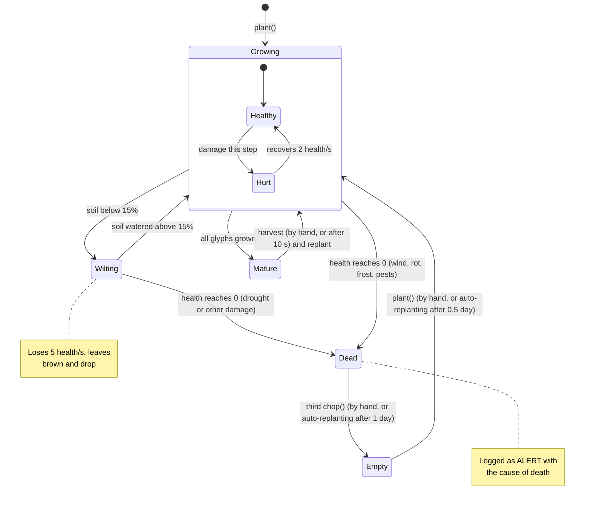

---

## 7. Sequence diagram: one simulation step

`GardenController`'s `AnimationTimer` calls `Garden.step(dt)` many times per frame (dt ≤ 0.25 s). Every module and plot runs inside `safely(...)`, so one failure can't stop the rest.

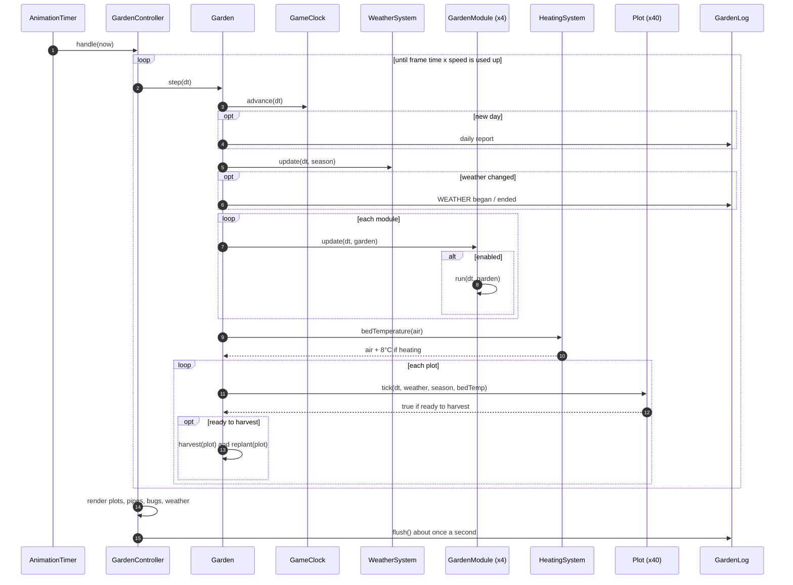

---

## 8. Sequence diagram: a cockroach attack

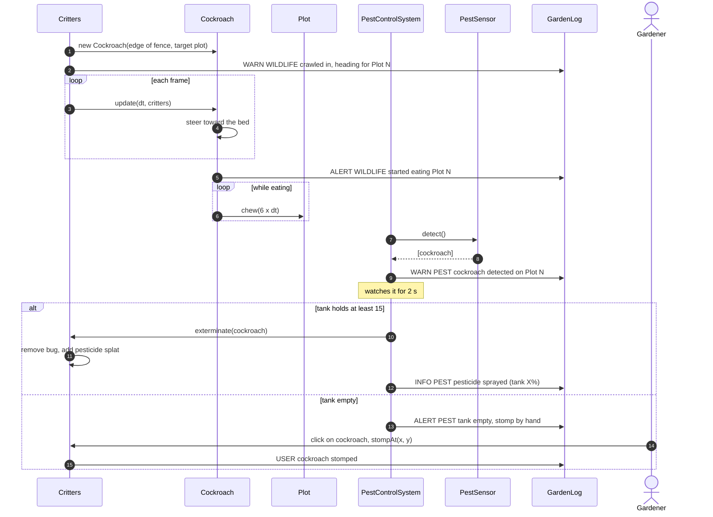

---

## 9. Sequence diagram: the gardener clicks a plot

The field's click filter tries a stomp first. Only if no cockroach is hit does the click reach the plot, where the plot's state chooses the action.

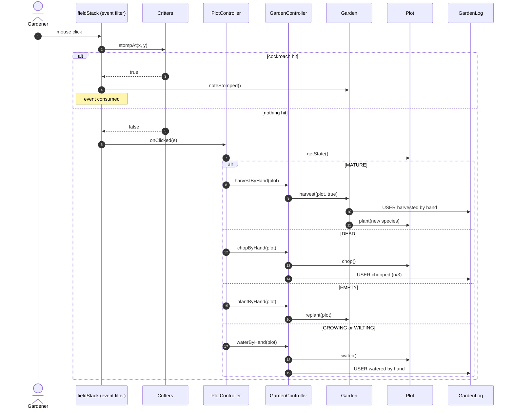

---

## 10. Activity diagram: watering decision

This is what `WateringSystem.run` decides for each plot on every step.

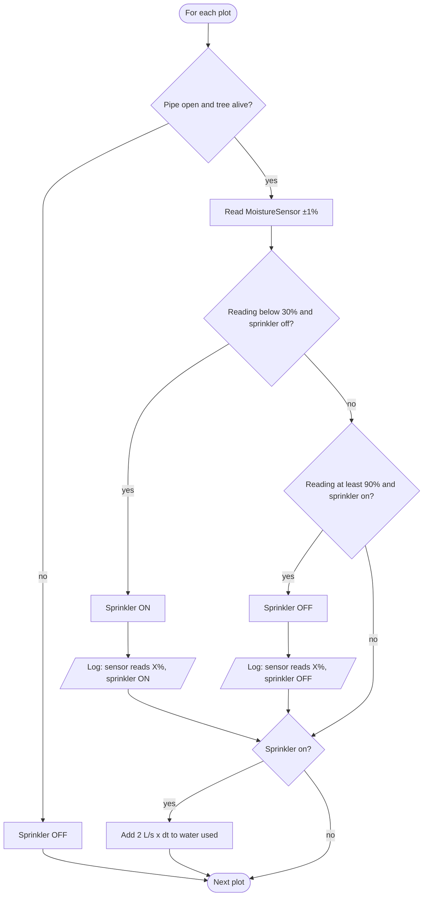

---

## 11. Activity diagram: frame loop with error recovery

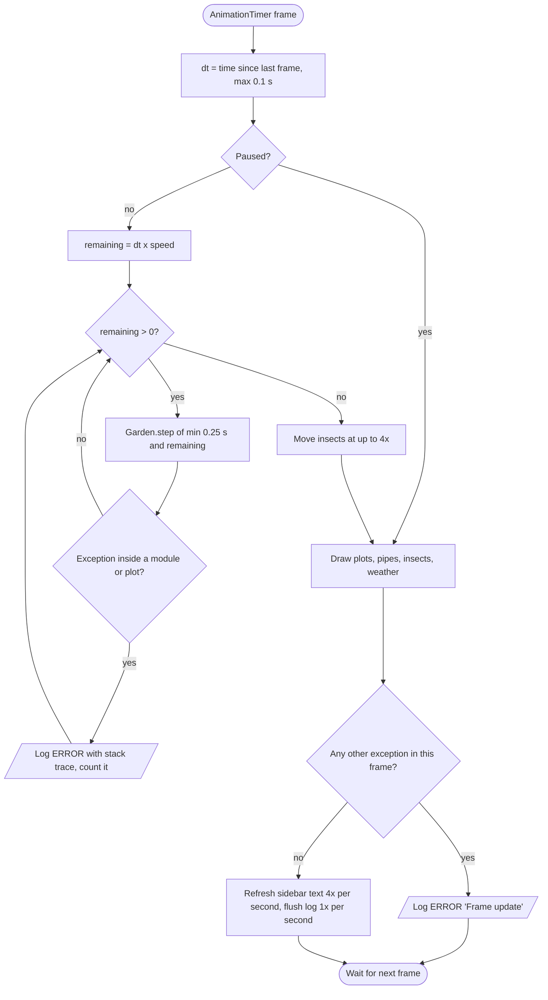
