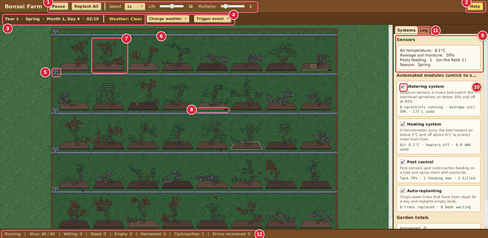

# Computerized Bonsai Garden: User Manual

The garden is a fenced field of 40 bonsai beds in 5 rows of 8. Each tree grows with the cbonsai branching algorithm. Water pipes run above every row, and four automated modules keep the garden alive: watering, heating, pest control and replanting. You can step in by hand at any time, or switch any module off and see what happens.

The same garden can also run with no window at all, driven by a test script through the Garden Simulation API. That is covered at the end of this manual and in docs/API.md.



## Installing and running

You need **Java 21 with JavaFX 21**. The simplest option is a JDK that already includes JavaFX, such as BellSoft Liberica JDK 21 "Full" or Azul Zulu 21 "JDK FX". A plain JDK 21 also works if you download the JavaFX 21 SDK from openjfx.io.

### With a JDK that includes JavaFX (macOS or Linux)

From the project folder, copy the window layouts and styles next to the compiled classes, compile, and start the app:

```bash
mkdir -p out/garden && cp src/garden/*.fxml src/garden/*.css src/garden/*.md out/garden/
javac -d out $(find src -name '*.java')
java -cp out garden.GardenApp
```

### With a plain JDK and the JavaFX SDK (macOS or Linux)

Replace `/path/to/javafx-sdk-21/lib` with the `lib` folder of the SDK you downloaded:

```bash
mkdir -p out/garden && cp src/garden/*.fxml src/garden/*.css src/garden/*.md out/garden/
javac --module-path /path/to/javafx-sdk-21/lib --add-modules javafx.controls,javafx.fxml -d out $(find src -name '*.java')
java --module-path /path/to/javafx-sdk-21/lib --add-modules javafx.controls,javafx.fxml -cp out garden.GardenApp
```

### On Windows (PowerShell, with a JDK that includes JavaFX)

```powershell
New-Item -ItemType Directory -Force out\garden | Out-Null
Copy-Item src\garden\*.fxml, src\garden\*.css, src\garden\*.md out\garden\
javac -d out (Get-ChildItem -Recurse src -Filter *.java).FullName
java -cp out garden.GardenApp
```

### In IntelliJ IDEA

- Open the project folder.
- In File, Project Structure, set the project SDK to a JDK 21 that includes JavaFX.
- Right-click the `src` folder and choose Mark Directory as, Sources Root. IntelliJ then copies the .fxml, .css and .md files next to the classes for you.
- Open `src/garden/GardenApp.java` and click the green run arrow next to `main`.

The window opens maximized. Log files are written to a `logs` folder inside the folder you started the app from.

## Quick start

- Start the app. The garden begins at 8:00 on day 1 of spring, Year 1, with 40 young trees.
- Watch the right-hand sidebar. The Systems tab shows sensor readings and the four modules. The Log tab shows everything that happens.
- Use the Speed box in the toolbar to go faster. At 256x a year passes in about 14 seconds.
- Hover over a bed to see its species, age, health, soil moisture and state.
- Leave it alone: the modules keep the garden alive on their own. Step in whenever you like.

## The screen at a glance

The numbers match the picture at the top of this manual.

- **1. Toolbar:** Pause, Replant All, Speed, Life and Multiplier (see The toolbar).
- **2. Help:** opens this manual.
- **3. Calendar and weather:** the year, season, month, day and time, and today's weather.
- **4. Change weather and Trigger event:** force the weather, or bring in a rare event.
- **5. Spigot:** the tap at the left end of each pipe. A blue cap means the row's water is on; a red cap means it is shut off.
- **6. Overhead pipe:** one per row. Spray falls from it over every bed whose sprinkler is on.
- **7. A bed:** one tree. Click it to water, harvest, chop or plant (see Clicking in the garden). Hover for details.
- **8. Health bar:** appears along a bed's front edge once its tree has been hurt.
- **9. Sensors:** air temperature, average soil moisture, pests feeding, and the season.
- **10. Module switch:** each module's checkbox. Untick it to switch that module off.
- **11. Log tab:** every event, with filters and a search box.
- **12. Status bar:** a one-line summary of the whole garden (see The status bar).

## Reading a bed

- **Soil colour** shows moisture: pale, dusty soil is dry and dark soil is wet.
- **Leaves turn brown** as a tree's health drops, and start falling off when it is badly hurt.
- **A bobbing gold star** above a tree means it is fully grown and ready to harvest.
- **A grey tree** is dead. A **black, charcoal tree** burned to death.
- **A stump with a pulsing green +** is an empty bed, ready to plant.
- **An orange glow** on the beds means the heating cables are on.
- **Flames** on a tree mean it is on fire.
- Trees **sway** in a windstorm and **shake** when you chop them.
- The **tooltip** (hover over a bed) shows the plot name, species and traits, soil moisture (and whether its sprinkler is on), health, age and state.

## The toolbar

- **Pause / Resume** freezes the simulation. Drawing continues.
- **Replant All** replaces every tree with a new random bonsai.
- **Speed** sets the simulation speed: 1x, 4x, 16x, 64x or 256x. Insects move at most 4x so you can still catch them.
- **Life** sets how big new trees grow (8 to 24).
- **Multiplier** sets how much new trees branch (2 to 8).
- **Help** opens this manual.
- **Change weather** (in the bar below the toolbar) forces Clear, Rain, Drought or Windstorm.
- **Trigger event** brings in a Hellfire Rider or a Green Brute right away (see Rare events).

## Clicking in the garden

- **Growing or wilting tree:** click to water it by hand (+35% soil moisture). If it's on fire, the water puts the fire out.
- **Green Brute:** click him 5 times to calm him down; he leaves without smashing any more trees.
- **Mature tree** (gold star): click to harvest it. A new tree is planted.
- **Dead tree** (grey): click 3 times to chop it down.
- **Empty bed** (stump with a green +): click to plant a new bonsai.
- **Cockroach:** click it to stomp it.
- **Spigot** (the chrome tap at the left end of each pipe): click to shut off or reopen that row's water. A blue cap means open; red means closed.

## Time and seasons

- 10 simulated seconds make one day. A month is 30 days, and a year is 12 months.
- Spring (months 1-3) brings lots of rain and fast growth.
- Summer (months 4-6) brings droughts, fast-drying soil and many cockroaches.
- Autumn (months 7-9) brings windstorms and slower growth.
- Winter (months 10-12) is cold. Nights fall below freezing, growth is slow and there are few pests.
- Night is drawn at 1x and 4x speed only.

## Weather

- **Clear:** normal conditions.
- **Rain:** waters every bed and makes cherry trees grow faster. Pine roots rot in waterlogged soil.
- **Drought:** soil dries 3 times faster and the air is about 7°C hotter.
- **Windstorm:** damages cherry and maple trees badly and juniper slightly. Pines are unharmed.

## Rare events

Every so often one of two troublemakers shows up: roughly every 15 to 35 in-game days at 1x speed. At higher speeds they come less often in game time, because visitors move at most 4x. You can also bring them in with **Trigger event**.

- **Hellfire Rider:** a skeleton biker with a flaming skull roars along one row of beds and sets every tree in that row on fire, leaving a trail of flames. He can't be stopped, but the fires can.
  - A burning tree loses 7 health per second. The fire also bakes the soil dry, which makes the Watering module switch that bed's sprinkler on.
  - A running sprinkler or rain makes the fire burn out much faster. Clicking a burning tree throws water on it and puts the fire out at once.
  - With the Watering module off, a whole row can burn to the ground. A tree that burns to death is left as black charcoal.
- **Green Brute:** a huge green brute stomps in from the side and smashes 3 to 5 trees, one after another. Each smash takes 45 health, so a tree that is already hurt can die from one blow. Click him 5 times to calm him down and he leaves early.

## The four species

- **Juniper:** drought-hardy and barely bothered by frost.
- **Cherry Blossom:** loves rain, but is fragile in wind and frost.
- **Japanese Maple:** thirsty in a drought, and hurt by wind and frost.
- **Pine:** ignores wind and frost, but its roots rot in waterlogged soil.

## Health and death

Every tree has health from 0 to 100. It loses health when:

- the soil is below 15% moisture (the tree wilts),
- a windstorm blows,
- rain falls on waterlogged soil (pines only),
- the bed is below 0°C (frost),
- a cockroach is eating it,
- it is on fire,
- or the Green Brute smashes it.

When nothing is hurting a tree, it recovers 2 health per second. At 0 health the tree dies, and the log records the cause. The Auto-replanting module clears it a day later, or you can chop it down and replant it yourself.

## The automated modules (Systems tab)

Each module has a checkbox. Untick it to switch the module off. The subsystems really run; nothing keeps the garden alive artificially. With a module off, trees will die of that cause.

- **Watering:** moisture sensors in each bed turn that bed's sprinkler on below 30% and off at 90%. A closed spigot cuts off the whole row, whatever the module wants.
- **Heating:** a temperature sensor turns on heating cables in the beds below 3°C and off above 6°C. They warm the beds by 8°C. The cables glow orange while on.
- **Pest control:** bed sensors confirm a feeding cockroach for 2 seconds, then spray it. Each spray uses 15% of the tank, which refills slowly. When the tank is empty you have to stomp them yourself.
- **Auto-replanting:** chops down trees that have been dead for a full day and replants beds left empty for half a day.

## Garden totals and the status bar

- **Garden totals** (at the bottom of the Systems tab) count trees harvested, trees that died, dead trees chopped by hand, cockroaches stomped by hand, cockroaches killed by pest control, and litres of water used.
- The **status bar** along the bottom shows, from left to right: Running or Paused; trees alive out of 40; trees wilting; dead trees; empty beds; trees harvested; cockroaches on the field; and **Errors recovered**.
- **Errors recovered** counts software problems the garden caught and survived. It should stay at 0. If it rises, the Log tab has an ERROR entry explaining what happened.

## Testing the modules yourself

Each module can be checked by switching it off and watching the trees suffer. Speed up to 64x to see results quickly, and watch the Log tab.

- **Watering:** untick Watering, then choose Drought from Change weather. The soil goes pale, trees wilt, and if you leave them they die. The log shows `DIED from drought (dry soil)`. Tick Watering again and the sprinklers come back on.
- **A single row:** instead of switching Watering off, click one spigot so its cap turns red. Only that row dries out.
- **Heating:** wait for winter (months 10 to 12) and untick Heating. On cold nights the log raises a frost ALERT, and cherry and maple trees lose health.
- **Pest control:** untick Pest control. Cockroaches now eat trees until you stomp them.
- **Auto-replanting:** untick it, and dead trees stay where they are until you chop them.

## The log

Every event is recorded twice: in the Log tab, and in a file in the `logs` folder next to where the app was started. See the separate Log Guide (docs/LOG_GUIDE.md) for the full format.

- Filter by **category** (WEATHER, PEST, USER and so on) or by **level** (INFO, WARN, ALERT, ERROR).
- Type in the search box to find, for example, `Plot 14:`, `DIED` or `frost`.
- Untick **Follow** to stop the list jumping to the newest entry.
- **Open log folder** shows the log files.
- A daily report is written at the end of every simulated day.

## Troubleshooting

- **"package javafx.application does not exist"** when compiling: your JDK has no JavaFX. Use a JDK that includes JavaFX, or the plain JDK commands with `--module-path` above.
- **"JavaFX runtime components are missing"** when starting: JavaFX is on the class path instead of the module path. Use the `--module-path` command above.
- **"Location is not set"** when starting: the .fxml, .css and .md files were not copied into `out/garden`. Run the copy step again.
- **The Help window says the manual is missing:** the same copy step was skipped.
- **Trees keep dying:** check that every module's checkbox is ticked, that no spigot cap is red, and what the Log tab says about the cause of death.
- **Where are the log files?** In the `logs` folder of the folder you started the app from. **Open log folder** in the Log tab goes straight there.

## Running the garden without a window (Garden Simulation API)

The graders' test script drives the garden through `GardenSimulationAPI`, with no window. It plants the garden from `garden-config.json`, treats each real hour as one simulated day, and writes everything to `log.txt` in the folder it runs from. It needs no JavaFX: any JDK 21 can build and run it. From the project folder:

```bash
javac -d out -sourcepath src src/GardenSimulator.java src/GardenSimulationAPI.java src/garden/api/*.java
java -cp out GardenSimulator 24 5000
```

That runs 24 days of 5 seconds each. Leave out `24 5000` for the full run of one real hour per day. The methods, the config file and the modules are described in docs/API.md, and `log.txt` is explained in the Log Guide.

## Robustness

The garden is built to run unattended for 24 hours or more. Each module, each plot and each frame runs inside its own error handler. If something goes wrong it is logged at ERROR level and counted in the status bar ("Errors recovered"), and the garden carries on.

## Credits

The tree growth algorithm is a Java port of cbonsai by John Allbritten (https://gitlab.com/jallbrit/cbonsai, GPL-3.0).
